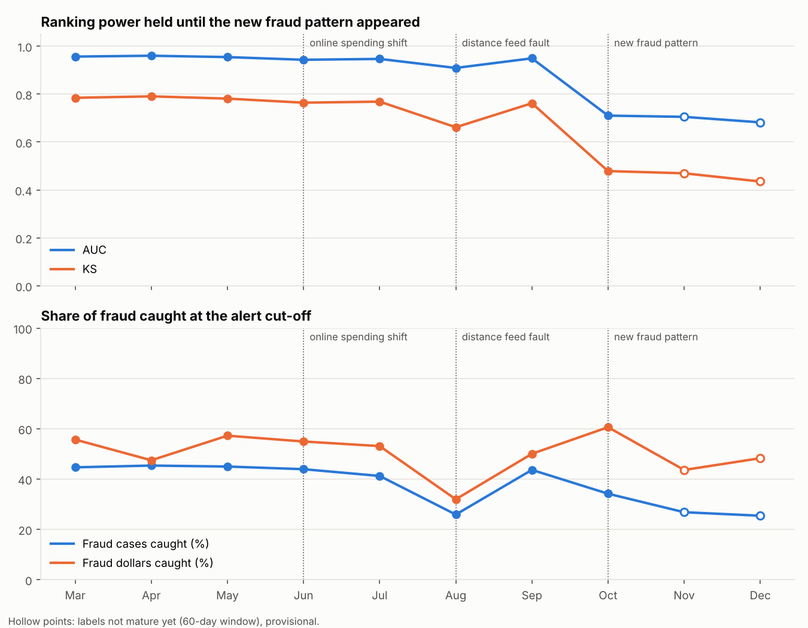
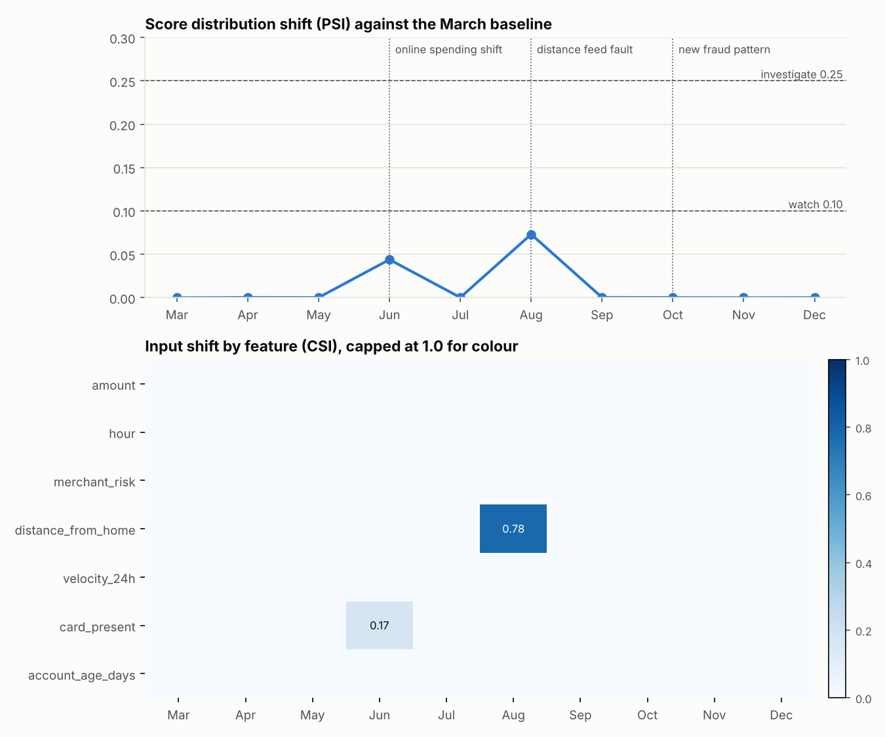
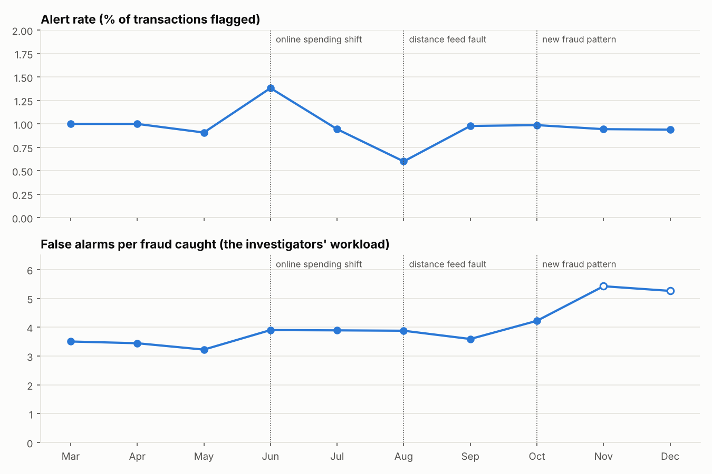

# Fraud Model Monitoring: Data Faults, Drift and New Fraud Patterns

**Tools:** Python (pandas, scikit-learn, Matplotlib), pytest · **Data:** simulated card transactions, 100,000 a month for 12 months, with three planted events

> Simulated data, built to practise the monthly monitoring a bank runs on its fraud models. No real customer data is used.

## Business question
A fraud model that worked at launch can quietly stop working. Which numbers should be checked every month, and how do you tell a data problem from a model problem before deciding what to do about it?

## What I did
- Trained a gradient-boosted fraud model on two months of transactions and validated it out of time on the third month, which became the baseline
- Set the alert cut-off for a 1% alert rate, then scored nine production months and compared each one with the baseline
- Wrote the checks as reusable functions (`monitoring/metrics.py`) that work on any score, including a vendor score whose internals you can't see: AUC and Gini, KS, PSI on the score, CSI on every input, alert rate, share of fraud cases and fraud dollars caught, and false alarms per fraud caught
- Built in label delay: the report runs as of January 2026, so November and December performance is provisional, because fraud is confirmed weeks after the transaction
- Added amber and red thresholds that give every month a status and a plain-language reason, plus unit tests for the metric functions

## Baseline (March, out of time)
AUC 0.957 · KS 0.785 · 44.7% of fraud cases and 55.7% of fraud dollars caught at a 1% alert rate · 3.5 false alarms per fraud caught

## What the monitoring caught
| Month | What happened | What the report showed | Status | Right response |
|---|---|---|---|---|
| Jun | Online spending rose: card-not-present share from 30% to 50% | CSI on `card_present` 0.17; AUC 0.943; alert rate up to 1.4% | Amber | Watch it. The inputs drifted but the model still ranks well; plan for more alerts |
| Aug | A feed delivered `distance_from_home` as 0 for 40% of transactions | CSI on distance 0.78; alert rate down to 0.6%; fraud cases caught down from 44.7% to 25.9% | Red | A data problem, not a model problem: fix the feed and rescore. No retraining |
| Oct | A new fraud type that looks like everyday spending, 36% of fraud | No input or score shift (PSI 0.000); AUC down to 0.710; fraud cases caught 34.2% | Red | A model problem: retrain on the newly labelled cases, add an interim rule, brief the fraud team |
| Nov, Dec | The new pattern continues | Stability checks clean; performance waits for labels | Pending | Stability checks alone would have said all was well |

## Key findings
- **Check the data before blaming the model.** The August feed fault cut fraud caught from 44.7% to 25.9%, yet the score PSI (0.073) stayed under the watch line. Only the input-level check, a CSI of 0.78 on distance, pointed to the cause.
- **Drift is not the same as degradation.** June's jump in online spending pushed an input past the watch line, but ranking power barely moved (AUC 0.943 against 0.957).
- **The most dangerous change moves nothing you can see.** The October fraud pattern left every input and the score distribution unchanged. Only outcome monitoring found it, and only once labels matured, which is why stability checks and performance checks are both needed.
- **Track dollars as well as cases.** The new fraud was small-ticket, so fraud dollars caught held up in October (60.6%) while fraud cases caught fell. Either measure alone tells half the story.

## Charts




## Files
| File | Description |
|---|---|
| `simulate.py` | Transaction generator with the three planted events |
| `monitoring/metrics.py` | PSI, KS, AUC and Gini, and alert metrics as reusable functions |
| `run_monitoring.py` | Trains the model, scores each month, writes the report, charts and findings |
| `tests/test_metrics.py` | Unit tests for the metric functions |
| `outputs/monitoring_report.csv` | One row per month: performance, stability, status and reason |
| `findings.txt` | Auto-generated summary |

## Run it
```bash
pip install -r requirements.txt
python run_monitoring.py
pytest tests
```
