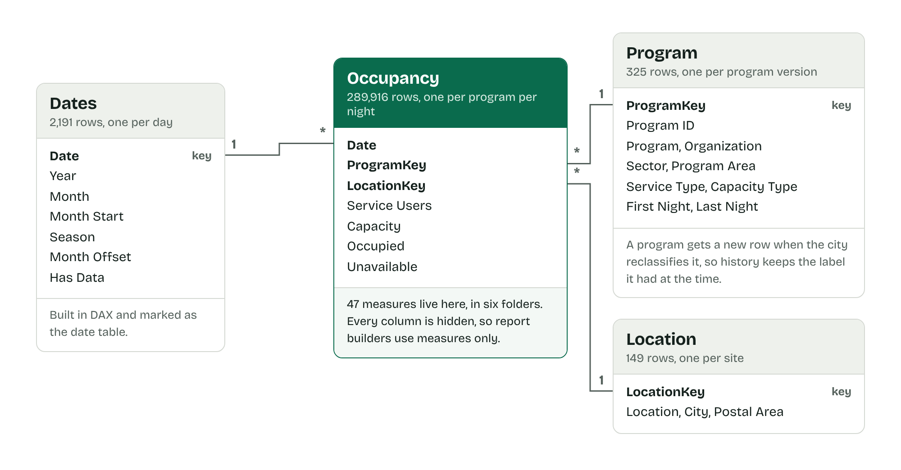

# Toronto's shelter system in Power BI

A four-page Power BI report on Toronto's shelter system, built on the City of Toronto's daily occupancy data: 289,916 program nights from January 2021 to October 2026. Every headline figure is also recalculated outside Power BI, in pandas, and the two have to agree.


**[Download the Power BI file](ShelterSystem.pbix)** · **[Read the case study](https://mohdaktham.github.io/projects/07-toronto-shelter-powerbi/)**

## What the report shows

- **Fewer people are in shelters than a year ago, but the system is still full.** An average of 6,977 people were sheltered each night in October 2026, 19.8% fewer than in October 2025 and 31.8% below the peak of 10,228 in January 2025. Beds were 96.2% occupied and rooms 99.2%, because capacity shrank too: beds available per night fell from 4,288 to 3,756, and rooms from 2,369 to 1,956.
- **Most of the past year's fall came from the temporary refugee response.** That program area went from 1,969 people a night to 738, which is 72% of the total drop. The base shelter system fell by 446 people a night, and hotel and motel programs went from 3,573 to 2,429.
- **Two in three program nights were completely full** in October 2026 (67.3%), down from a high of 88.8% in August 2024. Youth and family programs were full least often (44% and 56% of nights) and mixed adult programs most often (83%).

## The pages

| Page | What it answers |
| --- | --- |
| Overview | How many people are sheltered each night, how that compares with a year earlier and with the peak, and which program areas and sectors they are in |
| Capacity | How full beds and rooms are, how many are available, and how often programs are completely full, as a heat map by month |
| Programs | Which organizations shelter the most people and how each compares with a year earlier, by city, service type and program model |
| Checks | The headline figures, laid out to compare with the independent recalculation |

Sector and Program Area slicers are synced across the first three pages.

| Capacity | Programs |
| --- | --- |
|  |  |

## Data model



- **Occupancy** is the fact table, one row per program per night. The source reports beds and rooms in separate columns, and each program uses one or the other, so they fold into one set of columns (Capacity, Occupied, Unavailable) and the unit lives on the program.
- **Program** has one row per program version. The city reclassifies programs over time: 44 of the 279 programs changed at least once, for example when several refugee programs moved out of the base system in January 2023. A new row for each version keeps the label a program had at the time, the idea behind a type 2 slowly changing dimension.
- **Location** holds the latest name and address of each site. Nights with no location recorded point to a "Not reported" row with key 0, so no fact row is dropped by the relationship.
- **Dates** is a DAX calendar marked as the date table. Two helper columns drive the latest-month measures: Month Offset (0 for the latest month, -12 for a year earlier) and Has Data.

## DAX

47 measures in six display folders, each with a description that shows as a tooltip in the field list. Implicit measures are turned off, so every number on a visual comes from a named, documented measure. A few worth reading:

People per night averages over the nights that have data, so a month in progress is not understated.

```dax
People per Night = DIVIDE ( [Person Nights], [Nights Reported] )
```

The prior-year comparison only shifts dates that have data, so a part year is compared with the same part of the year before.

```dax
People per Night PY =
CALCULATE (
    [People per Night],
    CALCULATETABLE (
        SAMEPERIODLASTYEAR ( Dates[Date] ),
        Dates[Has Data] = TRUE ()
    )
)
```

The latest-month cards ignore the date filter but still respond to the sector and program filters.

```dax
People per Night (Latest Month) =
CALCULATE (
    [People per Night],
    REMOVEFILTERS ( Dates ),
    Dates[Month Offset] = 0
)
```

Chart and card titles are measures too ("People sheltered per night, October 2026"), so they stay right after every refresh, and the heat map takes its colours from a measure. Beds and rooms are never added together: occupancy is reported for each.

## How the numbers are checked

`reconcile.py` loads the same three CSV files with pandas and recalculates the headline figures without Power BI. The Checks page shows the same figures from the DAX measures.

| Figure | Filter | Python |
| --- | --- | --- |
| Program Nights | all dates | 289,916 |
| Person Nights | all dates | 17,941,778 |
| Nights Reported | all dates | 2,130 |
| Programs | all dates | 279 |
| Locations | all dates | 148 |
| People per Night | all dates | 8,423.4 |
| Occupancy % | all dates, beds | 97.55% |
| Occupancy % | all dates, rooms | 98.41% |
| Full Program Nights % | all dates | 72.56% |
| Latest Month | all dates | October 2026 |
| People per Night (Latest Month) | 2026-10 | 6,976.9 |
| People per Night (Year Earlier) | 2025-10 | 8,697.6 |
| Change vs Year Earlier % | 2026-10 | -19.78% |
| Bed Occupancy % (Latest Month) | 2026-10 | 96.23% |
| Room Occupancy % (Latest Month) | 2026-10 | 99.22% |
| Full Program Nights % (Latest Month) | 2026-10 | 67.35% |
| Peak Month | all dates | January 2025 |
| People per Night (Peak Month) | 2025-01 | 10,227.5 |
| Change from Peak % | 2026-10 | -31.78% |


## Files

| File | What it is |
| --- | --- |
| `ShelterSystem.pbix` | The report as one Power BI file, with the data loaded. Open it in Power BI Desktop |
| `powerbi/` | The same report as a Power BI project: the model in TMDL and the report in PBIR, readable as text in Git |
| `prepare_data.py` | Downloads the yearly files from Toronto Open Data and writes the star schema to `data/` |
| `data/` | `fact_occupancy.csv`, `dim_program.csv` and `dim_location.csv` |
| `reconcile.py` | Recalculates the headline figures in pandas and writes `checks/expected_values.csv` |
| `images/` | The report pages and the data model diagram |

## Run it

```bash
pip install pandas
python prepare_data.py     # downloads the source files and writes data/
python reconcile.py        # writes checks/expected_values.csv
```

Open `ShelterSystem.pbix` in Power BI Desktop to explore the report as it is. To rebuild it from the data, open `powerbi/ShelterSystem.pbip` and choose Refresh. The model reads the CSV files from this repository at a fixed commit, so a refresh gives the same numbers. To use files you prepared yourself, choose Transform data, then Edit parameters, and set DataFolder to your `data` folder, ending with a backslash.

## About the data

City of Toronto Open Data, [Daily Shelter & Overnight Service Occupancy & Capacity](https://open.toronto.ca/dataset/daily-shelter-overnight-service-occupancy-capacity/), published under the Open Government Licence (Toronto). The model covers complete months only, January 2021 to October 2026.

- The counts are people staying in the City's shelter and overnight services on a night. People sleeping outdoors or staying in other systems are not included.
- 45 program nights report more people than capacity. They are kept as reported and count as full. 319 nights have no out-of-service figure.
- The data shows what changed, not why. Reasons for the fall in refugee response programs need sources beyond this dataset.
